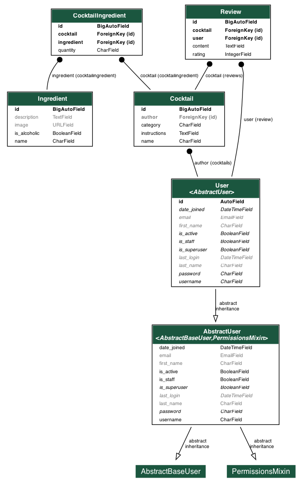

# Cocktail Manager API

REST API for managing cocktails and their ingredients, built with **Django** (plain Django — no Django REST Framework).

## Features

- Full CRUD for cocktails and ingredients
- Relational model: `Cocktail` ↔ `Ingredient` via a through table (`CocktailIngredient`) with per-cocktail quantities, plus `Review` and an `author` link to `User`
- Session-based authentication: register, login, logout
- Two roles: regular **User** and **Admin** (`is_superuser`)
- Permission rules:
  - everyone can read cocktails, ingredients and reviews
  - only a logged-in user can create a cocktail/ingredient or post a review
  - only the author or an admin can edit/delete a cocktail
  - only an admin can edit/delete an ingredient
- Pagination, filtering and sorting on the list endpoints
- Hand-written OpenAPI schema + Swagger UI
- Automated tests: unit, integration and end-to-end

## Tech stack

- Python 3.12
- Django 6.1
- PostgreSQL
- `python-dotenv` for configuration
- `django-extensions` + `pydot` (dev-only, used to render the DB schema diagram)

## Project structure

```
cocktails/            # the app
  models.py           # Ingredient, Cocktail, CocktailIngredient, Review
  views.py            # plain Django class-based views (JsonResponse)
  urls.py             # all /api/... routes
  openapi.py          # OpenAPI spec + Swagger UI
  tests/              # unit, integration and e2e tests
config/               # Django project (settings, root urls)
docs/db-schema.*      # database schema diagram (PNG + SVG)
```

## Setup

### Prerequisites

- Python 3.12+
- PostgreSQL running

### Installation

```bash
git clone <repo-url>
cd solvro-backend

python -m venv venv
source venv/bin/activate            # Windows: venv\Scripts\activate

pip install -r requirements.txt
pip install -r requirements-dev.txt # optional, for regenerating the DB diagram
```

### Configuration

Copy `.env.example` to `.env` and fill in your PostgreSQL credentials:

```bash
cp .env.example .env
```

| Variable      | Description                          | Default     |
| ------------- | ------------------------------------ | ----------- |
| `DB_NAME`     | PostgreSQL database name             | —           |
| `DB_USER`     | PostgreSQL user                      | —           |
| `DB_PASSWORD` | PostgreSQL password                  | —           |
| `DB_HOST`     | PostgreSQL host                      | `localhost` |
| `DB_PORT`     | PostgreSQL port                      | `5432`      |

### Database

```bash
python manage.py migrate
python manage.py createsuperuser   # admin account
```

### Run

```bash
python manage.py runserver
```

The API is served under `/api/`. Swagger UI is available at <http://localhost:8000/api/docs/> and the raw OpenAPI document at <http://localhost:8000/api/schema/>.

## Tests

```bash
python manage.py test
```

## API endpoints

| Method | Endpoint                          | Description                          | Access            |
| ------ | --------------------------------- | ------------------------------------ | ----------------- |
| POST   | `/api/auth/register/`             | Register a new user                  | public            |
| POST   | `/api/auth/login/`                | Log in (sets a session cookie)       | public            |
| POST   | `/api/auth/logout/`               | Log out                              | any               |
| GET    | `/api/ingredients/`               | List ingredients (paginated)         | public            |
| POST   | `/api/ingredients/`               | Create an ingredient                 | logged in         |
| GET    | `/api/ingredients/{id}/`          | Retrieve an ingredient               | public            |
| PUT    | `/api/ingredients/{id}/`          | Update an ingredient                 | admin             |
| DELETE | `/api/ingredients/{id}/`          | Delete an ingredient                 | admin             |
| GET    | `/api/cocktails/`                 | List cocktails (paginated)           | public            |
| POST   | `/api/cocktails/`                 | Create a cocktail                    | logged in         |
| GET    | `/api/cocktails/{id}/`            | Retrieve a cocktail                  | public            |
| PUT    | `/api/cocktails/{id}/`            | Update a cocktail                    | author or admin   |
| DELETE | `/api/cocktails/{id}/`            | Delete a cocktail                    | author or admin   |
| GET    | `/api/cocktails/{id}/reviews/`    | List reviews for a cocktail          | public            |
| POST   | `/api/cocktails/{id}/reviews/`    | Add a review                         | logged in         |

### Filtering and sorting

List endpoints accept `page` and `per_page` query parameters.

**Ingredients** (`/api/ingredients/`):

- `name` — case-insensitive substring match
- `is_alcoholic` — `true` or `false`
- `sort` — `id`, `-id`, `name`, `-name`, `is_alcoholic`, `-is_alcoholic`

**Cocktails** (`/api/cocktails/`):

- `author_id` — filter by author
- `ingredient` — case-insensitive match on ingredient name (e.g. `?ingredient=mint`)
- `is_alcoholic` — `true` / `false` (non-alcoholic = no alcoholic ingredients)
- `sort` — `id`, `-id`, `name`, `-name`, `category`, `-category`

Example: non-alcoholic cocktails containing mint, sorted by name:

```
GET /api/cocktails/?ingredient=mint&is_alcoholic=false&sort=name
```

## Database schema



A vector version is available at `docs/db-schema.svg`. The diagram is generated from the models with `django-extensions`:

```bash
python manage.py graph_models cocktails auth --exclude-models Group,Permission -o docs/db-schema.png
```

`auth` is included only to show the referenced `User` model; `Group` and `Permission` are excluded to reduce noise.
